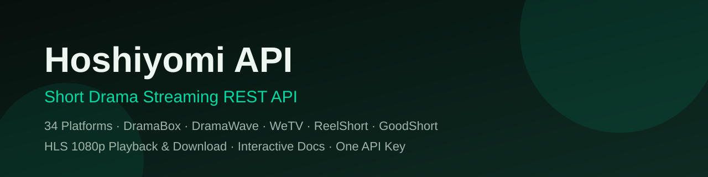

<div align="center">



# 🎬 Hoshiyomi API

### Short Drama Streaming REST API — 34 Platforms, One API Key

**Watch, search and download short dramas** from DramaBox, DramaWave, WeTV, ReelShort,
GoodShort and 29 more platforms — HLS 1080p playback & download, interactive Try-It docs,
and a VIP hosting tier (API v3).

[](https://apiv2.hoshiyomi.my.id/docs)
[](https://apiv3.hoshiyomi.my.id/docs)
[](https://t.me/dramaboxplusbot)
[](https://www.hoshiyomi.my.id/)
[](https://t.me/dramaboxplusbot)

</div>

---

## 📖 About

Hoshiyomi API comes in **three tiers** — pick the one that fits your plan:

| API | Base URL | Platforms | Tier | Status |
|-----|----------|-----------|------|--------|
| 🇲 **API v1 (Starter)** | `https://api.hoshiyomi.my.id` | 20+ | Starter / Growth | Starter tier — limited stability |
| ⭐ **API v2 (MAIN)** | `https://apiv2.hoshiyomi.my.id` | **34** | Pro & higher | **Most stable — actively updated. Recommended.** |
| 👑 **API v3 (Hosting)** | `https://apiv3.hoshiyomi.my.id` | 2 (DramaWave, GoodShort) | Linked keys | **Premium — runs on *your own* VIP account: everything your account unlocks, the API unlocks** |

> ⭐ **Recommendation:** Pro and above should build on **API v2** — it is the main,
> actively-developed API with the newest platforms (WeTV, KalosTV, Velolo, Reelala, …).
> Choose **API v3** to run DramaWave or GoodShort **hosted on your own VIP account** —
> every episode your account unlocks (paid included, with VIP) comes out as ready-to-play/download URLs.

### Built for

Drama streaming apps & websites · Telegram/Discord drama bots · media centers
(Jellyfin / Plex / Kodi via m3u8) · episode downloaders · catalog & recommendation tools —
the same endpoints power our own [demo web](https://www.hoshiyomi.my.id/).

### Why Hoshiyomi API?

- **One API, 34 Platforms** — no need to integrate multiple platforms separately
- **HLS 1080p** — high-resolution streams with token-protected relay
- **Hosted on your VIP account (API v3)** — what your account unlocks, the API unlocks; paid episodes included for VIP
- **Multi-language catalogs** — Indonesian, English, Chinese, Spanish, and more (per platform)
- **Interactive Documentation** — live Try-It on every platform page
- **Real-time Monitoring** — WebSocket rate-limit & usage stats

---

## 🚀 Quick Start

### 1. Get Your API Key

Via Telegram Bot: **[@dramaboxplusbot](https://t.me/dramaboxplusbot)**
- 🆓 **Trial** — 10 RPM, limited daily quota, 1 day — automatic via the bot
- 🌱 **Starter** — 500 RPM · 15K/day · API v1 · 5 GB/day bandwidth
- 💼 **Pro** — 10K RPM · 200K/day · API v2 (MAIN) · 25 GB/day
- 👑 **API v3 (Hosting)** — linked keys only: bring your **own VIP account**, we host the session (1 key = 1 account). Ask the admin to link your key

### 2. Make Your First Request (API v2 — MAIN)

**cURL:**
```bash
curl -s "https://apiv2.hoshiyomi.my.id/api/dramas/dramabox/trending?lang=en" \
  -H "X-API-Key: HOSHIYOMI-PRE-YOUR_KEY"
```

**Python:**
```python
import requests

resp = requests.get(
    "https://apiv2.hoshiyomi.my.id/api/dramas/dramabox/trending",
    params={"lang": "en"},
    headers={"X-API-Key": "HOSHIYOMI-PRE-YOUR_KEY"},
)
for drama in resp.json()["data"]:
    print(drama["id"], "-", drama["title"])
```

**JavaScript:**
```javascript
const res = await fetch(
  "https://apiv2.hoshiyomi.my.id/api/dramas/wetv/trending?lang=en",
  { headers: { "X-API-Key": "HOSHIYOMI-PRE-YOUR_KEY" } }
);
const data = await res.json();
console.log(data);
```

### 3. Make Your First Request (API v3 — Hosting / VIP)

One call returns a playable HLS URL — everything **your VIP account** unlocks (paid included):

```bash
# DramaWave: playable master playlist (paste into any player / ffmpeg)
curl -s "https://apiv3.hoshiyomi.my.id/api/dramawave/stream?series_id=SERIES_ID&episode_key=EPISODE_KEY&q=best&format=m3u8&apikey=YOUR_KEY"

# GoodShort: ready-to-play episode playlist (paid chapters included)
curl -s "https://apiv3.hoshiyomi.my.id/api/goodshort/v1/hls/CHAPTER_ID?bookId=BOOK_ID&apikey=YOUR_KEY"
```

Download a full episode with ffmpeg (works for both platforms):

```bash
ffmpeg -allowed_extensions ALL \
  -i "https://apiv3.hoshiyomi.my.id/api/dramawave/stream?series_id=SERIES_ID&episode_key=EPISODE_KEY&q=best&format=m3u8&apikey=YOUR_KEY" \
  -c copy -movflags +faststart episode01.mp4
```

---

## 📡 API v2 Endpoints (MAIN)

All endpoints: `https://apiv2.hoshiyomi.my.id/api/dramas/{source}/{endpoint}`

| Endpoint | Method | Description | Parameters |
|----------|--------|-------------|------------|
| `/trending` | GET | Platform trending dramas | `lang` (opt), `page` (opt), `limit` (opt) |
| `/search` | GET | Platform search | `q` (req), `lang` (opt) |
| `/{id}` | GET | Drama detail | `lang` (opt) |
| `/{id}/episodes` | GET | Episode list | `lang` (opt), `with_urls` (opt — embed stream URLs) |
| `/{id}/play/{ep}` | GET | Resolve one episode stream (fresh token) | `lang` (opt) |
| `/{id}/hls/{chapterId}` | GET | HLS manifest for an episode | `lang` (opt) |

**Utilities:**

| Endpoint | Description |
|----------|-------------|
| `GET /api/stream?u=<token>` | Opaque-token HLS/MP4 relay (Range supported) |
| `GET /sources` | List active platform ids |
| `GET /ratelimit/:key` | Key status: RPM, daily quota, tier |
| `GET /health` | Health check |
| `WS /ws/stats` | Real-time WebSocket stats |

> ℹ️ The legacy **global** endpoints (`/api/trending`, `/api/search`) are removed —
> use the per-platform endpoints above (they answer `410 endpoint_disabled`).

---

## 👑 API v3 Endpoints (Hosting — VIP included)

All endpoints: `https://apiv3.hoshiyomi.my.id` · auth via `X-API-Key` header or `?apikey=` query.
Every response is a normal JSON payload — and every stream is a standard HLS playlist
(`#EXT-X-KEY` handled automatically by any player). **Whatever your account can watch is streamable —
paid episodes/chapters included with a VIP account.**

**DramaWave** — catalog & streams (interactive docs: [`/docs`](https://apiv3.hoshiyomi.my.id/docs)):

| Endpoint | Description |
|----------|-------------|
| `GET /api/dramawave/feed` | For-You feed (cursor pagination `?next=`, `lang`) |
| `GET /api/dramawave/detail?series_id=` | Series detail + full episode list |
| `GET /api/dramawave/chapters?series_id=` | Compact episode list (`offset`/`limit`) |
| `GET /api/dramawave/search?q=` | Search (suggestions + novels) |
| `GET /api/dramawave/stream?series_id=&episode_key=&q=&format=m3u8` | **Playable/downloadable HLS URL** (`q=worst\|best\|<height>p`) |

**GoodShort** — catalog & streams (interactive docs: [`/docs/goodshort`](https://apiv3.hoshiyomi.my.id/docs/goodshort)):

| Endpoint | Description |
|----------|-------------|
| `GET /api/goodshort/v1/home` | Home catalog (sections) |
| `GET /api/goodshort/v1/chapters/:bookId` | Chapter list with pricing flags |
| `GET /api/goodshort/v1/hls/:chapterId?bookId=` | **Playable/downloadable HLS URL** (paid chapters included) |
| `GET /api/goodshort/v1/search?q=` | Search dramas |
| `GET /api/goodshort/v1/book/:id` | Drama detail |
| `GET /api/goodshort/segment?url=` | Media segment (player-facing, referenced by playlists) |

---

## 👑 Request Hosting (API v3) — Use Your Own Account

API v3 runs **your own VIP account** on our hosting: we keep your account session alive,
and your API key unlocks **everything your account unlocks** — paid episodes included.

**How to request:**

1. Contact the admin via **[@dramaboxplusbot](https://t.me/dramaboxplusbot)** (or [@Widiharu](https://t.me/Widiharu))
2. Provide: platform (**DramaWave** / **GoodShort**), your account login / session, and your API key
3. We host the session in a **dedicated slot** — 1 account = 1 key, never shared
4. You receive a **linked key** → call `https://apiv3.hoshiyomi.my.id` and use the interactive docs

**What you get:**

- ✅ Everything **your account** unlocks → ready-to-play / downloadable HLS URLs (up to 1080p)
- ✅ Isolated slot per buyer (1:1 key ↔ account) — other keys can never touch your session
- ✅ Interactive Try-It docs — [`/docs`](https://apiv3.hoshiyomi.my.id/docs) (DramaWave) · [`/docs/goodshort`](https://apiv3.hoshiyomi.my.id/docs/goodshort) (GoodShort)
- ✅ Your existing API v1 / v2 plan keeps working unchanged

> 💡 Bring your **own VIP account** — whatever it can watch, your API can stream and download.

---

## 📱 Supported Platforms (34)

| | | | |
|---|---|---|---|
| CubeTV | DotDrama | DramaBite | **DramaBox** |
| **DramaWave** ⭐ | FlareFlow | FlexTV | FlickReels |
| FreeReels | **GoodShort** ⭐ | HappyShort | iDrama |
| KalosTV | Melolo | MicroDrama | MoboReels |
| NetShort | PineDrama | Reelala | ReelBuzz |
| ReelLife | ReelShort | Serial+ | ShortMax |
| ShortsWave | StardustTV | StarShort | StoryReel |
| Velolo | VibeShort | **WeTV** 🆕 | ZebraShort |

⭐ = also available on **API v3**, hosted on your own VIP account (paid included with VIP).

Full live list: [`GET /sources`](https://apiv2.hoshiyomi.my.id/sources) ·
Per-platform docs with Try-It: [apiv2.hoshiyomi.my.id/docs](https://apiv2.hoshiyomi.my.id/docs)

---

## 🌐 Demo Web

**[https://www.hoshiyomi.my.id](https://www.hoshiyomi.my.id/)** — a public demo of the API in action:

- Browse all 34 platforms — no login required
- **Episodes 1–10 free** to watch (later episodes intentionally locked)
- Powered end-to-end by API v2

---

## 🤖 Telegram Bot

Keys, payments & monitoring via **[@dramaboxplusbot](https://t.me/dramaboxplusbot)**

- 🆓 Trial keys — automatic, claim anytime via the bot
- 💳 Paid plans — QRIS / OKX / Binance / Crypto, auto-delivery
- 📊 Real-time rate limit & usage monitoring
- 🌐 Multi-language (EN/ID)

---

## 🔑 Key Format

| Format | Example | Description |
|--------|---------|-------------|
| Paid | `HOSHIYOMI-PRE-xxxxxxxx` | All paid tiers — Pro+ unlocks API v2 (MAIN) |
| Linked | `HOSHIYOMI-PRE-xxxxxxxx` | Same key, **linked** to API v3 by the admin — runs on **your own VIP account** (its session is hosted here) |

> One key format for everything. For API v3 the key must be *linked*: each linked key is
> paired 1-to-1 with **its own VIP account session** — you provide the account, we host it.
> Contact the admin to link yours.

---

## ❌ Error Codes

| Code | Description |
|------|-------------|
| 400 | Bad Request — invalid parameters |
| 401 | Unauthorized — invalid or missing API key |
| 403 | Forbidden — plan does not include this API (`pro_plan_required`), key suspended, or not linked to API v3 (`dramawave_key_required`) |
| 404 | Not Found — platform/resource not found |
| 410 | Gone — legacy global endpoints removed (use per-platform) |
| 429 | Too Many Requests — rate limit / bandwidth exceeded |
| 502 | Upstream provider error |
| 503 | Platform under maintenance |

---

## 🌍 Language Support

Catalogs are per-platform. Common codes: `en` · `in`/`id` (Indonesian) · `zh` · `es` · `pt` · and more —
each platform page in the docs lists its supported languages.

---

## 📚 Documentation

| API | Docs |
|-----|------|
| ⭐ **API v2 (MAIN)** | [apiv2.hoshiyomi.my.id/docs](https://apiv2.hoshiyomi.my.id/docs) |
| 🇲 API v1 (Starter) | [api.hoshiyomi.my.id/docs](https://api.hoshiyomi.my.id/docs) |
| 👑 **API v3 (Hosting)** | [apiv3.hoshiyomi.my.id/docs](https://apiv3.hoshiyomi.my.id/docs) (DramaWave) · [apiv3.hoshiyomi.my.id/docs/goodshort](https://apiv3.hoshiyomi.my.id/docs/goodshort) (GoodShort) |

---

## ❓ FAQ

**What is the DramaBox API / short drama API?**
A REST API that aggregates short drama streaming platforms (DramaBox, DramaWave, WeTV, ReelShort,
GoodShort and 29 more) behind a single API key — search, trending, detail, episode lists and
playable HLS streams.

**Can I watch or download short dramas with this API?**
Yes. Every stream endpoint returns a standard HLS playlist (`m3u8`) that plays in any player
(VLC, mpv, hls.js, ExoPlayer) and downloads with `ffmpeg -c copy` — up to 1080p.

**How do I get an API key for short drama streaming?**
Claim a Trial key automatically via the [@dramaboxplusbot](https://t.me/dramaboxplusbot) Telegram bot,
or pick a paid plan (Starter / Pro). For API v3 you can also **host your own VIP account**.

**Does it support multi-language drama catalogs?**
Yes — `lang` per request: Indonesian (`in`/`id`), English (`en`), Chinese (`zh`), Spanish (`es`),
Portuguese (`pt`) and more, depending on the platform.

**Is there a free short drama API tier?**
A Trial tier exists (limited RPM & daily quota). Paid tiers unlock API v2 with 34 platforms and
higher limits.

---

## 📞 Support

- **Telegram Bot:** [@dramaboxplusbot](https://t.me/dramaboxplusbot)
- **Admin:** [@Widiharu](https://t.me/Widiharu)
- **GitHub Issues:** [Create an issue](https://github.com/beranalpa/dramabox-asia-api/issues)

---

<div align="center">

**Built with ❤️ for drama lovers worldwide**

[](https://apiv2.hoshiyomi.my.id/docs)
[](https://apiv3.hoshiyomi.my.id/docs)

</div>
